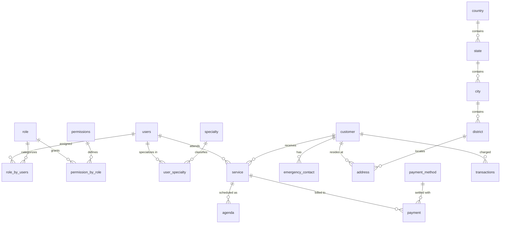

<div align="center">
  <h1>🏥 Aven Clinic (Sanctuary Health)</h1>
  <p><em>Enterprise-Grade Clinical Operating System, Real-Time Triage & Medical Analytics Suite</em></p>
  
  <p>
    
    
    
    
    
    
  </p>
</div>

<br />

**Aven Clinic** (Sanctuary Health) is a modern, high-performance healthcare management platform engineered to streamline clinical workflows, patient triage queues, doctor scheduling, and financial operations. Built for clinics, multi-specialty medical centers, and hospitals, it provides real-time visibility into operational capacity, clinical staff performance, electronic health records (EHR), and automated billing.

---

## ✨ Key Features & Clinical Modules

### 1. 📊 Executive Dashboard & Live Patient Queue
- **Real-Time Clinical Queue:** Live tracking of patients across all triage stages (*Waiting*, *In Triage*, *Consultation*, *Observation*).
- **Capacity & Occupancy Charts:** Dynamic hourly, weekly, and monthly tracking of bed and room utilization vs. maximum operational capacity.
- **Key Health Indicators:** Average wait time, doctor consultation resolution rates, and live clinical status metrics.

### 2. 📅 Medical Agenda & Appointment Scheduling
- **Multi-View Calendar:** Interactive agenda supporting Day, Week, and Month visualization modes.
- **Smart Status Workflow:** Filter and transition appointments between *Scheduled*, *Confirmed*, *En Route*, *In Progress*, *Completed*, and *Cancelled*.
- **Doctor Slot Allocation:** Seamless booking based on doctor working hours, shift schedules, and room availability.

### 3. 👥 Patient Directory & Clinical Intake
- **Patient Profiles:** Complete demographic records, Medical Record Numbers (MRN), contact info, and birth dates.
- **Clinical Triage Classification:** Urgency priority tagging (*Normal*, *Urgent*, *Critical*) for fast ER and outpatient prioritization.
- **Medical Essentials:** Blood type tracking, allergies list, and primary emergency contacts per patient.

### 4. 🩺 Clinical Staff, Specialists & Shift Management
- **Medical Directory:** Organization of doctors, specialists, nurses, and administrative staff.
- **Working Hours & Shifts:** Per-specialist working day configurations (`working_days` JSON) and daily operating windows (`start_time` - `end_time`).
- **Performance & Ratings:** Patient feedback ratings, attendance metrics, overtime hours, and compliance certifications (HIPAA, BLS/ACLS).

### 5. 💳 Financial Operations, Billing & Point of Sale (POS)
- **Multi-Payment Processing:** Integrated handling for Credit Cards, Debit Cards, Cash, Health Insurance/Copay, Wire Transfers, and Digital Wallets.
- **Audit Transactions:** Financial ledger linking medical services to payments, amounts, status, and transaction dates.
- **PDF Invoicing:** Instant patient receipt and invoice generation with branded export functionality.

### 6. 🏥 Clinic Practice Information & System Parameters
- **Facility Branding:** Logo management, legal tax ID (TIN/EIN), emergency phone numbers, and address details.
- **Operating Hours:** Global schedule definitions, consultation slot durations, and cancellation window policies.
- **Configurable System Parameters:** Dynamic key-value configuration table (`system_parameters`) to tune clinic behavior without redeploying code.

---

## 🗄️ Database Architecture (Supabase PostgreSQL)

The backend is backed by a relational PostgreSQL schema deployed on Supabase, designed with enterprise RBAC, audit trails, and strict foreign-key integrity:



### Core Database Tables

| Table | Description |
| :--- | :--- |
| `public.users` | Clinical staff & doctors with `working_days`, `start_time`, `end_time`, status, and `auth_user_uid` link to Supabase Auth. |
| `public.role` | Granular security roles (*Administrator*, *Doctor*, *Nurse*, *Receptionist*, *Billing Specialist*). |
| `public.permissions` | Route and action permissions for UI pages and backend operations. |
| `public.permission_by_role` | Mapping between permissions and roles. |
| `public.role_by_users` | Association table between system users and their assigned roles. |
| `public.specialty` | Medical departments (*General Practice*, *Cardiology*, *Dermatology*, *Pediatrics*, etc.). |
| `public.user_specialty` | Relationship table connecting doctors to medical specialties. |
| `public.customer` | Clinical patients with MRN, contact info, birthday, gender, urgency level, blood type, and allergies. |
| `public.emergency_contact` | Emergency contact records linked directly to patients. |
| `public.address` | Patient addresses with geographic coordinates and district mapping. |
| `public.assistant_address` | Clinical practice locations and physician office addresses. |
| `public.service` | Medical service requests and consultation packages (dates, frequencies, recurrences). |
| `public.agenda` | Calendar slots and appointment instances linking patients, doctors, and rooms. |
| `public.payment_method` | Accepted payment methods (Credit, Debit, Cash, Insurance, Digital Wallet). |
| `public.transactions` | Financial ledger and revenue auditing for clinical visits. |
| `public.payment` | Payment receipts with amounts, reference codes, notes, and cashier audit. |
| `public.country`, `state`, `city`, `district` | Geographic hierarchy for regional operations. |
| `public.system_parameters` | Configurable practice settings (branding, consultation duration, operating hours, currency). |

### Convenience Views (Domain Aliases)
- **`public.patients`**: Flattens `customer` data with full name, clinical urgency, blood type, and allergies.
- **`public.appointments`**: Joins `agenda`, `customer`, `users`, `service`, and `specialty` for calendar queries.
- **`public.staff`**: Aggregates `users`, `role_by_users`, `role`, and `specialty` for staff directories.

---

## 🛠️ Tech Stack

- **Frontend:** **[Next.js 16](https://nextjs.org/)** (App Router, Server Components, API Handlers)
- **UI Framework:** **[React 19](https://react.dev/)**
- **Styling:** **[Tailwind CSS v4](https://tailwindcss.com/)** with custom healthcare design system
- **Database & Auth:** **[Supabase](https://supabase.com/)** (PostgreSQL 15+, PL/pgSQL Triggers, RLS, `@supabase/ssr`)
- **Language:** **[TypeScript 5](https://www.typescriptlang.org/)** with strict type safety
- **Icons & Typography:** Google Material Symbols Rounded & Geist Sans

---

## 🚀 Getting Started & Local Setup

### 1. Prerequisites
- **Node.js**: `v20.x` or higher
- **npm** or **pnpm**
- A **[Supabase](https://supabase.com/)** project account
- Git installed on your system

### 2. Clone the Repository
```bash
git clone https://github.com/WalterMartinez20/aven-clinic-next.git
cd aven-clinic-next
```

### 3. Install Dependencies
```bash
npm install
```

### 4. Configure Environment Variables
Copy the example environment file:
```bash
cp env.example .env.local
```
Add your Supabase project credentials in `.env.local` (obtained from **Project Settings > API** in your Supabase dashboard):
```env
NEXT_PUBLIC_SUPABASE_URL="https://your-project.supabase.co"
NEXT_PUBLIC_SUPABASE_ANON_KEY="your-anon-public-key"
```

### 5. Apply Database Migrations (Supabase)

You can run the schema migration in either of two ways:

#### Option A: One-Click SQL Editor (Recommended)
1. Open your Supabase Dashboard and navigate to the **SQL Editor**.
2. Open the file `supabase/schema.sql` located in this repository.
3. Paste the contents into the SQL Editor and click **Run**.
   *This automatically sets up all sequences, tables, constraints, foreign keys, views, auth synchronization triggers, and seed data (roles, permissions, specialties, payment methods, and system parameters).*

#### Option B: Supabase CLI
```bash
supabase db push
```

### 6. Run the Development Server
```bash
npm run dev
```

Open [http://localhost:3000](http://localhost:3000) in your browser to explore the platform.

---

## 📁 Project Structure

```text
aven-clinic-next/
├── public/                     # Static assets (logos, images, avatars)
├── src/
│   ├── app/                    # Next.js App Router (pages & API routes)
│   │   ├── (auth)/             # Authentication views (Login, Recovery)
│   │   ├── admin/              # Clinic Administration & Operations
│   │   │   ├── account/        # Practice info & branding configuration
│   │   │   ├── agenda/         # Appointment calendar scheduling
│   │   │   ├── analytics/      # Patient, Staff, Financial & Platform metrics
│   │   │   ├── patients/       # Patient directory & triage intake
│   │   │   └── staff/          # Specialist directory & shifts
│   │   └── api/                # Backend API route handlers
│   ├── components/             # Reusable UI component library
│   ├── hooks/                  # Custom React hooks (auth, modals, filters)
│   ├── lib/
│   │   └── supabase/           # Supabase client & SSR setup
│   ├── services/               # API service layer (auth, staff, agenda, billing)
│   └── types/                  # TypeScript interfaces & database definitions
│       └── database.types.ts   # Supabase tables, views, and domain types
├── supabase/
│   ├── migrations/             # Versioned SQL migrations
│   │   ├── 01_clinical_core_schema.sql
│   │   └── 02_auth_triggers_and_seed.sql
│   └── schema.sql              # Unified execution script for Supabase SQL Editor
└── README.md                   # Comprehensive documentation
```

---

## 👨‍💻 Author & Engineering Credits

**Walter Martínez** — Systems Engineering Student at *Universidad Gerardo Barrios* (El Salvador). Passionate about scalable full-stack web applications, resilient database architectures, and intuitive digital health systems.

- 💼 **LinkedIn:** [Walter Martínez](https://www.linkedin.com/in/walter-martínez-4712162b7)
- 🐙 **GitHub:** [@WalterMartinez20](https://github.com/WalterMartinez20)
- 🌐 **Repository:** [aven-clinic-next](https://github.com/WalterMartinez20/aven-clinic-next)

---

<div align="center">
  <small>© 2026 Aven Clinic / Sanctuary Health. Engineered with care for clinical excellence.</small>
</div>
